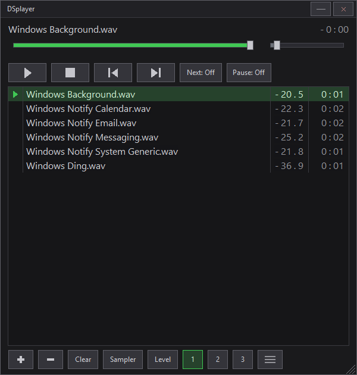

<p align="center">
  
</p>

<h1 align="center">DSplayer</h1>

<p align="center">
  A native Win32 audio player for Windows x64 powered by BASS.
</p>

<p align="center">
  
</p>

DSplayer provides three playlists, LUFS loudness measurement, Auto and -dB
volume modes, a 10-pad sampler, a waveform editor with A-B markers, a level
meter, and a scalable interface. MP3 files can be exported without
re-encoding: the original frames are copied byte for byte without ID3 tags.

> **Important:** `DSplayer.exe` does not include the BASS libraries. The
> program cannot start until `bass.dll`, `bassloud.dll`, `bassmix.dll`,
> `basswasapi.dll`, and `bassasio.dll` are placed next to the executable.

## Download

A prebuilt 64-bit executable is available here:

- [Download DSplayer.exe](dist/DSplayer.exe)

The executable requires the BASS DLLs, which are not included in the
repository. Download the current 64-bit SDK packages from Un4seen
Developments:

| Package | Download | Required DLL |
| --- | --- | --- |
| BASS 2.4 | [bass24.zip](https://www.un4seen.com/files/bass24.zip) | `bass.dll` |
| BASSloud 2.4 | [bassloud24.zip](https://www.un4seen.com/files/bassloud24.zip) | `bassloud.dll` |
| BASSmix 2.4 | [bassmix24.zip](https://www.un4seen.com/files/bassmix24.zip) | `bassmix.dll` |
| BASSWASAPI 2.4 | [basswasapi24.zip](https://www.un4seen.com/files/basswasapi24.zip) | `basswasapi.dll` |
| BASSASIO 1.4 | [bassasio14.zip](https://www.un4seen.com/files/bassasio14.zip) | `bassasio.dll` |

Place the executable and all five DLLs in one directory:

```text
DSplayer\
|-- DSplayer.exe
|-- bass.dll
|-- bassloud.dll
|-- bassmix.dll
|-- basswasapi.dll
`-- bassasio.dll
```

Use the DLL from the `x64` folder of each package. Do not rename it, and do not
copy it into `C:\Windows\System32`. The
[Microsoft Visual C++ Redistributable x64](https://learn.microsoft.com/cpp/windows/latest-supported-vc-redist)
must also be installed if it is not already present. No ASIO driver is required
for WASAPI output.

Start `DSplayer.exe` by double-clicking it or from PowerShell:

```powershell
.\DSplayer.exe
```

The build is not code-signed, so Windows SmartScreen may display a warning.
Make sure the executable was downloaded from this repository.

### If the executable does not start

- Confirm that Windows 10 or 11 x64 is being used.
- Confirm that all five DLLs are next to `DSplayer.exe`.
- Make sure the DLL file names have not been changed.
- Make sure the extracted libraries are x64 versions, not x86.
- Install or repair the Microsoft Visual C++ Redistributable x64 if Windows
  reports `MSVCP140.dll`, `VCRUNTIME140.dll`, or `VCRUNTIME140_1.dll` missing.

## Features

- Three independent playlists with track reordering and drag support.
- LUFS loudness measurement and automatic volume correction.
- Auto mode, -dB attenuation, and a configurable playback delay.
- A 10-pad sampler with independent volume and smooth stopping.
- A waveform view with zoom, scrolling, and A-B markers.
- MP3 range export without re-encoding.
- WASAPI and ASIO output with live device switching.
- A scalable interface with a dark visual style.

Supported formats are MP3, MP2, MP1, OGG, WAV, AIFF/AIF, MOD, XM, S3M, IT,
MTM, UMX, and MO3. MP3 range export is available only for MP3 files.

## Using DSplayer

1. Use `+` to add audio files to the visible playlist.
2. Select a track and start playback.
3. Use `Sampler` for the pad controls and `Level` for the output meter.
4. Load a pad, then use `R` to open its waveform and set the A-B range.
5. For an MP3 file, use the track context menu to export a range without
   re-encoding. The waveform window can also export the selected A-B range.
6. Use `Settings` to change interface scaling and audio output.

## Data files

DSplayer creates `playlist_1.txt` through `playlist_3.txt`, `loudness.txt`,
`sampler.txt`, and `settings.txt` next to the executable. The registry is not
used. User data and build output are excluded from Git.

## Build from source

Requirements:

- Windows 10 or 11 x64.
- Visual Studio 2026 (`18.x`) with x64 C++ build tools and the Windows SDK.
- 64-bit BASS, BASSloud, BASSmix, BASSWASAPI, and BASSASIO SDKs.

From the project root, run:

```bat
cmd /c build.bat Release
```

The result is `bin\x64\Release\DSplayer.exe`. The build copies `bass.dll`,
`bassloud.dll`, `bassmix.dll`, `basswasapi.dll`, and `bassasio.dll` next to it.

The project uses toolset `v145`. `build.bat` locates Visual Studio through
`vswhere` and builds `Player.sln` with msbuild for x64.

The BASS headers and libraries are required for compilation. Keep them in the
local working directory; they are excluded from Git:

```text
bass.h
bass.lib
bass.dll
Additions\
  bassloud24\
  bassmix24\
  basswasapi24\
  bassasio14\
```

After rebuilding the application, copy the new
`bin\x64\Release\DSplayer.exe` to `dist` so the download link points to the
current release.

## License and third-party components

The original DSplayer source code and executable are distributed under the
[MIT License](LICENSE).

BASS, BASSloud, BASSmix, BASSWASAPI, and BASSASIO are products of Un4seen
Developments and are not covered by the MIT license. Their current licensing
terms are published on the [Un4seen website](https://www.un4seen.com/bass.html#license).
BASS is free for non-commercial use by non-commercial entities that do not make
money from the product, including through sales or advertising. Commercial use
requires a license from Un4seen Developments. The BASS DLLs are not
redistributed by this repository.

DSplayer is not affiliated with or endorsed by Un4seen Developments. This
repository does not grant rights to BASS or to audio files processed by the
program. Users are responsible for complying with Un4seen's licensing terms and
for ensuring that they have permission to play, process, and export their audio
files.
